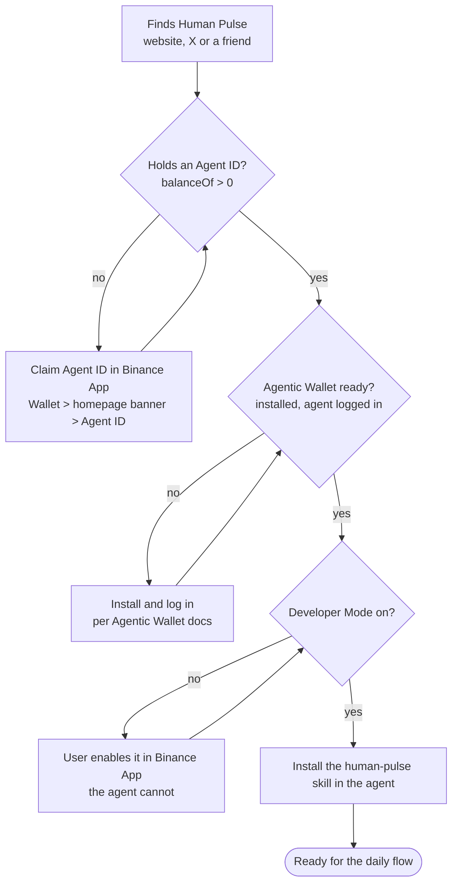
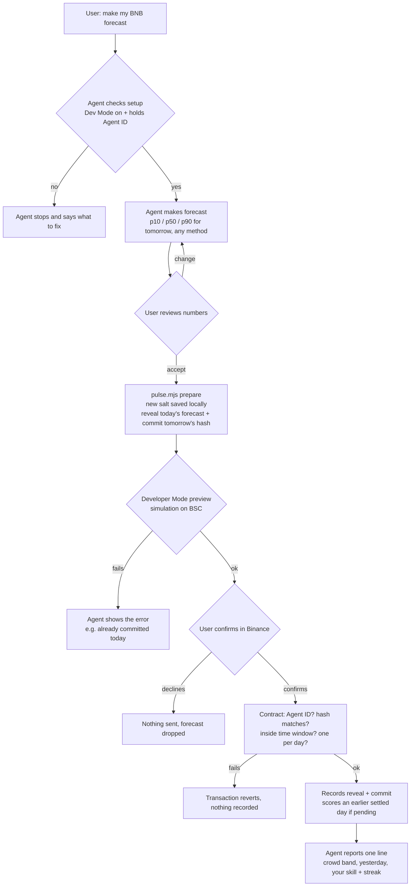
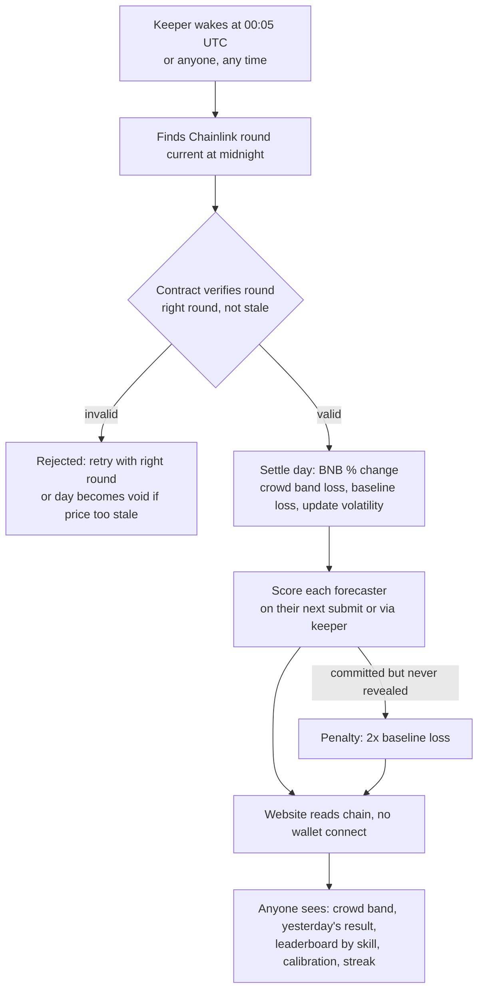

# Human Pulse: architecture and design

> Working name. "Human Pulse" clashes with an existing Solana project, so the
> final name must be picked **before the mainnet deploy on Nov 25**.

Hackathon: Binance Wallet x BNB Chain **Agent ID Hackathon**
([rules](https://www.binance.com/en/support/announcement/detail/95f5dbe0ea674a48a739b59e046648bf)).
Submission closes **2026-12-09 08:00 UTC**. Claude-assisted build ends **Nov 26**.

This file is the interface contract between the contract (T-A tasks) and the skill and website
(T-B, T-C tasks). Changing section 5 or the commit hash encoding needs both owners to agree in
the PR. Who does what and when is in `TASKS.md`; decisions taken since are in `DECISIONS.md`,
which wins where the two disagree.

---

## 1. The problem

Every crypto "sentiment" or "prediction" number today can be faked. One person
with 500 bots or 500 wallets can make the crowd say anything, and a forecaster's
track record can be bought, deleted or cherry-picked. So nobody trusts crowd
forecasts, and good forecasters can't prove they are good.

## 2. The idea

A daily BNB forecast made only by **real, verified humans**, one per
**Binance Agent ID**, with every forecast locked on-chain and scored
automatically against Chainlink.

- **Agent ID = one human.** Each Binance user can claim only one Agent ID and it
  can't be transferred, so 500 bots can't become 500 forecasters.
- **The agent does the work.** Each holder's AI agent (running in their
  Agentic Wallet) makes the forecast however it wants: its own model, market
  data, the user's opinion. We only define the format.
- **Forecasts are ranges, not just up/down.** Each agent submits three numbers
  for tomorrow's BNB % change: a low (p10), a middle (p50) and a high (p90).
  That captures direction *and* expected volatility.
- **Scoring rewards honesty.** A proper scoring rule (pinball loss) means the
  best strategy is to report what you truly believe. A huge "safe" range loses
  points; a too-narrow range loses more when it misses.
- **Nobody can copy.** Forecasts are committed as a hash first and revealed
  later, so you can't see and copy someone else's forecast before your own is
  locked.
- **Everyone is compared with a baseline.** A simple automatic forecast
  ("no change, with recent volatility as the band") is scored alongside. An
  agent only shows skill if it beats the baseline over time.

What people get:
- **Everyone:** today's *crowd band* (where real humans' agents expect BNB to
  land tomorrow) and how accurate the crowd has been.
- **Each holder:** a public, unfakeable track record: skill vs baseline,
  calibration, streak.

It is a sentiment and forecasting signal, **not financial advice**, and the
product holds and moves **no funds**.

## 3. How it works: one day in the life

Days are UTC days. Day `D` runs from `D × 86400` to `(D+1) × 86400` seconds.
A forecast "for day D" is a forecast of BNB's % change from the start of day D
to the start of day D+1, measured with Chainlink BNB/USD.

```
           Day D-1                    Day D                     Day D+1
  |-------------------------|-------------------------|-------------------------|
   agent COMMITS forecast    agent REVEALS forecast     keeper SETTLES day D
   for day D (hash only)     for day D (numbers)        (needs price at start
                             + COMMITS for day D+1      of D+1); agents' scores
                             (same transaction)         for day D are computed
```

1. **Day D-1: commit.** The user tells their agent: *"make my daily BNB
   forecast"*. The agent decides p10 / p50 / p90 for day D, generates a random
   secret (salt), stores both locally, and sends **one transaction** containing
   only a hash of them. The user sees a preview and confirms it in Binance.
2. **Day D: reveal + next commit.** Next day, the same one-transaction routine
   reveals yesterday's numbers + salt (the contract checks they match the hash)
   **and** commits the forecast for day D+1. So the user still does
   **one confirm per day**.
3. **Start of day D+1: settle.** Anyone (our keeper script, or any user) calls
   `settle` with the Chainlink round that was current at the day boundary. The
   contract verifies the round, records the price, computes day D's actual %
   change, the crowd band's score and the baseline's score.
4. **Scoring.** Each agent's day-D forecast is scored (automatically on their
   next submit, or by anyone calling `score`). Their stats update: skill vs
   baseline, calibration (how often the outcome landed inside their p10 to p90),
   streak.
5. **Website** reads everything straight from the chain and shows the crowd
   band, yesterday's result and the leaderboard.

Missing a day is fine: the agent just commits again. A forecast that was
committed but never revealed is scored as a **penalty** (see §5.4), so nobody
can hide bad forecasts.

### 3a. User flow: one-time setup



### 3b. User flow: daily forecast (one confirm per day)



### 3c. Settlement and results (no user needed)



## 4. Architecture

```
 User (Binance App)                 Agent (Claude / other)          BSC mainnet
 ┌──────────────────┐  "make my    ┌──────────────────────┐        ┌──────────────────────┐
 │ Agent ID holder  │  forecast"   │ human-pulse SKILL.md │  1 tx  │ PulseForecast        │
 │ Developer Mode on├─────────────▶│ + pulse.mjs helper   ├───────▶│  commit / reveal     │
 │ confirms each tx │◀── preview ──│ (salt kept locally)  │        │  settle / score      │
 └──────────────────┘              └──────────────────────┘        │  reads: Agent ID NFT │
                                                                   │         Chainlink    │
 Keeper (cron, our key, ~$0.003/day) ── settle(day, roundId) ─────▶│  no owner, no funds  │
                                                                   └──────────┬───────────┘
 Website (static, Vercel, viem, no wallet connect) ◀── read-only RPC ─────────┘
```

Three deliverables (plus a small keeper script):

| Piece | Tech | Purpose |
|---|---|---|
| `contracts/`: **PulseForecast** | Solidity, Foundry | Agent ID gate, commit-reveal, settlement, scoring, stats |
| `skills/human-pulse/`: **agent skill** | `SKILL.md` + `pulse.mjs` (Node, viem) | Lets any agent make, commit and reveal forecasts safely |
| `web/`: **website** | Vite + viem, static on Vercel | Crowd band, results, leaderboard, how to join |
| `keeper/`: **settle script** | Node, viem; run daily (GitHub Actions cron or by hand) | Calls `settle` just after 00:00 UTC |

## 5. Contract design: `PulseForecast`

### 5.1 Immutable config (set once at deploy)

| Param | Value |
|---|---|
| `agentId` | `0x60b9262456de011f7d15a54cdd8c48baaa8b022f` (SPACE ID Agent ID, ERC-721, non-transferable; holder = `balanceOf > 0`) |
| `feed` | Chainlink BNB/USD on BSC `0x0567F2323251f0Aab15c8dFb1967E4e8A7D42aeE` (checked live Nov 23: 8 decimals, ≈ $555) |
| `maxStale` | Max age of the Chainlink round at a day boundary (e.g. 2 h); older → day is void |
| `initialSigma` | Starting volatility for the baseline (e.g. 250 bps/day) |

No owner, no admin, no pause, no upgrades, no `payable`, no token transfers.

### 5.2 Forecast format

Three `int32` values in **basis points** of % change (100 bps = 1%):
`p10 ≤ p50 ≤ p90`, each within ±5000 bps (±50%).
Example: `p10 = -300, p50 = 40, p90 = 350` means "90% sure it ends above −3%,
best guess +0.4%, 90% sure it ends below +3.5%".

Commit hash: `keccak256(abi.encode(voter, day, p10, p50, p90, salt))`.
Including `voter` and `day` stops someone replaying another person's hash.

### 5.3 Functions

| Function | Who | What it does |
|---|---|---|
| `submit(bytes32 nextCommit, bool hasReveal, int32 p10, int32 p50, int32 p90, bytes32 salt)` | Agent ID holder | The daily one-tx call: reveals today's forecast (if `hasReveal`), commits tomorrow's, then scores the holder's latest settled-but-unscored day |
| `commit(bytes32 hash)` | Agent ID holder | Commit for tomorrow only (first day, or after a gap) |
| `reveal(int32 p10, int32 p50, int32 p90, bytes32 salt)` | Agent ID holder | Reveal today's forecast only |
| `settle(uint64 day, uint80 roundId)` | Anyone | Records the Chainlink price at the start of `day+1` using the given round, verifies it was the round current at the boundary, finalises `day` |
| `score(address voter, uint64 day)` | Anyone | Scores one holder's settled day (lets the keeper/website clean up) |
| Views: `today()`, `dayInfo(day)`, `crowdBand(day)`, `stats(voter)`, `forecastOf(voter, day)`, `baselineBand(day)` | Anyone | Read data for the website and skill |

Events: `Committed(voter, day)`, `Revealed(voter, day, p10, p50, p90)`,
`Settled(day, openPrice, closePrice, changeBps, crowdLoss, baselineLoss)`,
`Scored(voter, day, loss, baselineLoss, inBand)`.

Rules enforced:
- Commit for day `D` only during day `D-1`; one commit per (holder, day).
- Reveal for day `D` only during day `D` (after the forecast window closed,
  before the day ends), must match the hash.
- Agent ID checked on commit (`balanceOf(msg.sender) > 0`).
- No loops over voters anywhere; every function is O(1).

### 5.4 Settlement and scoring math

**Price at a boundary.** `settle(day, roundId)` checks with `getRoundData` that
round `r` was updated at or before the boundary, and round `r+1` after it
(or `r` is the latest round). Also checks `boundary − updatedAt(r) ≤ maxStale`.
If valid, `price[day+1] = answer(r)`. Our keeper finds `r` off-chain by binary
search, but anyone can supply it; the contract trusts nothing but Chainlink.

**Outcome.** `change[D] = (price[D+1] − price[D]) × 10000 / price[D]` in bps.
Day D is settled when both prices exist. If a price can't be recorded within
`maxStale`, the day is **void** (no one is scored).

**Pinball loss** for each quantile `q ∈ {0.1, 0.5, 0.9}`, forecast `x`,
outcome `y`:

```
loss_q = q·(y − x)        if y ≥ x
       = (1 − q)·(x − y)  if y < x
loss   = loss_0.1 + loss_0.5 + loss_0.9      (lower is better)
```

**Baseline for day D:** `p50 = 0`, `p10 = −1.2816·σ`, `p90 = +1.2816·σ`, where
`σ` is an on-chain moving estimate of daily volatility (EWMA,
`σ² ← 0.94·σ² + 0.06·change²`), updated after each settled day. So the baseline
is "no change, with recently observed volatility": a fair, dumb benchmark.

**Crowd band for day D:** the average of all revealed p10s, p50s and p90s
(averaging quantiles is a standard way to combine forecasts). It's scored with
the same loss.

**Unrevealed commit** = scored as `2 × baseline loss` that day, so withholding a
bad forecast is always worse than revealing it.

**Holder stats** (per address): days committed, days scored, missed reveals,
total loss, total baseline loss, days inside own p10 to p90 band, current streak of
beating the baseline, last scored day.

- **Skill** = `(total baseline loss − total loss) / days scored`. Positive =
  better than the baseline.
- **Calibration** = days inside band / days scored. Ideal ≈ 80%.

### 5.5 Security notes

- Holds no funds; no `payable`; no approvals; no external calls except reads of
  Agent ID and Chainlink.
- No owner or privileged role exists, so there is nothing to disclose beyond
  "none", still documented in the README per the rules.
- Commit includes voter + day → no hash replay.
- Selective reveal is penalised (§5.4).
- Can't vote with a non-holder wallet; can't commit twice for a day.
- Chainlink staleness and round verification prevent stale or chosen prices.

## 6. Agent skill: `skills/human-pulse/`

`SKILL.md` (plain-language) + `pulse.mjs` helper. Flow the agent follows:

1. **Check setup:** Developer Mode is on (`baw wallet settings --json` →
   `devMode.enabled`; exact commands to be confirmed against the
   [official Agentic Wallet skill](https://github.com/binance/binance-skills-hub/tree/main/skills/binance-web3/binance-agentic-wallet)).
   If off, tell the user to enable it in the Binance App: the agent can't.
2. **Make the forecast:** the agent decides p10 / p50 / p90 any way it likes
   (the skill suggests a simple method using public market data, but any
   method is fine). Shows the numbers to the user in one line.
3. **Prepare the transaction:** `node pulse.mjs prepare --p10 … --p50 … --p90 …`
   generates the salt, stores it in a local state file, adds yesterday's reveal
   if there is one, and prints the calldata for `submit(...)`.
4. **Preview → user confirms → execute** through Agentic Wallet Developer Mode.
   The skill **never** confirms on the user's behalf and never tells the agent
   to skip confirmation.
5. **Report:** `node pulse.mjs status` reads the chain and prints one line:
   today's crowd band, yesterday's result, the user's skill and streak.

The salt file stays on the user's machine. Losing it only means that one
forecast can't be revealed (and gets the penalty).

## 7. Website: `web/`

Static site (Vite + viem), read-only from a public BSC RPC. **No wallet
connect, no `name.ai` names.** Sections:

- **Today:** crowd band for today (once reveals arrive), number of verified
  humans who committed for tomorrow, the baseline band.
- **Yesterday:** actual BNB change vs crowd band vs baseline; did the crowd
  beat the baseline?
- **Leaderboard:** shortened addresses only, ranked by skill vs baseline
  (minimum 5 scored days), with calibration and streak.
- **How to join:** install the skill, enable Developer Mode, copy-paste prompt.
- **Footer:** "Forecasting signal only. Not financial advice. No returns are
  promised." + contract address and BscScan link.

## 8. Keeper: `keeper/`

`settle.mjs`: at 00:05 UTC, finds the Chainlink round at the boundary and calls
`settle(yesterday, roundId)`; optionally calls `score` for holders not yet
scored. Uses a small hot wallet that holds only gas money (~0.005 BNB). Runs via
GitHub Actions cron or by hand. If it ever fails, anyone can call `settle`.

## 9. Rules compliance

| Official rule | How we comply |
|---|---|
| Deployed on BNB Chain, verified + open source on BscScan | Mainnet deploy, `forge verify-contract`, public GitHub repo |
| Actively use Agent ID | Every commit is gated on Agent ID; one forecaster per human is the core of the product |
| No web QR / pairing-code login, no stored sessions | No login at all; website is read-only |
| Skills must not bypass transaction confirmation | Skill always runs preview → user confirms → execute |
| No unauthorized asset transfers / unlimited approvals | Contract moves no assets, needs no approvals |
| Open source with disclosed owner permissions | No owner permissions exist; stated in README |
| No Binance/BNB brand impersonation | Final name avoids "Binance"/"BNB" |
| No collecting credentials | Nothing collected; salt stays on the user's machine |
| No promised returns | No rewards, no money; "not financial advice" everywhere |
| Risk warning for trading products | Disclaimer on site and in skill output |
| Agent ID not a "look up wallets by name" tool | No names shown; shortened addresses only |
| No volume manipulation / mass registration | No test wallets used to inflate numbers; one human per Agent ID by design |

## 10. How it scores on the Innovation Award

| Criterion (weight) | Our angle |
|---|---|
| Agent ID depth (30%) | Agent ID *is* the anti-Sybil layer; without it the product can't exist |
| Practicality (25%) | Unfakeable crowd forecast + verifiable forecaster track records |
| Completion (25%) | Live mainnet contract, working skill, live website, real users |
| Innovation (20%) | Agent-native forecasting network with proper scoring and commit-reveal |

## 11. Roadmap (pitch only, not built now)

1. More assets in the same transaction (BTC, ETH).
2. **Unique contribution** scoring: credit each agent by how much it improves
   the crowd band when included vs left out, so copies earn nothing.
3. **Paid layer:** traders subscribe to the crowd band; fees go to agents with
   positive skill over a rolling window. Needs documented owner powers, risk
   warnings and legal review before mainnet.

## 12. Repo layout

```
binance-wallet-hackathon/
├── CLAUDE.md, TASKS.md, OPERATOR_TODO.md, DECISIONS.md   # the board, from hydra
├── README.md                 # what it is, how to use, owner powers: none
├── docs/ARCHITECTURE.md      # this file
├── contracts/                # Foundry project
│   ├── src/PulseForecast.sol
│   ├── test/PulseForecast.t.sol        # unit tests with mocks (CI)
│   ├── test/fork/PulseForecast.fork.t.sol  # BSC mainnet fork tests (local only)
│   └── script/Deploy.s.sol
├── skills/human-pulse/
│   ├── SKILL.md
│   └── pulse.mjs
├── keeper/settle.mjs
├── deployments/              # testnet.json, mainnet.json
├── spikes/F<n>/              # feasibility spikes
├── web/                      # Vite + viem static site
└── scripts/board.mjs         # board lint
```

## 13. Tests

Unit (mock Agent ID + mock Chainlink feed):
- non-holder can't commit; holder can
- double commit for the same day rejected
- reveal outside its day rejected; wrong salt / numbers rejected; p10 > p50 rejected; out-of-range rejected
- settle with wrong / stale round rejected; correct round accepted
- day rollover: commit → reveal → settle → score gives the expected pinball loss
- baseline σ update and baseline loss
- crowd band average and crowd loss
- unrevealed commit gets the penalty
- void day (stale price) scores nobody
- one-tx `submit` does reveal + commit + score together

Fork (BSC mainnet):
- a real Agent ID holder address (via `vm.prank`) can commit; a fresh address can't
- real Chainlink feed: `settle` with a real historical round at a real day boundary

## 14. Schedule

The schedule, owners and waves live in `TASKS.md` section 5; human-only steps
(wallets, Developer Mode, Vercel, the name) live in `OPERATOR_TODO.md`.

**Go/no-go on Nov 25 (T-F03, T-J01):** if a real Agentic Wallet can't send a
custom contract call in Developer Mode, stop and rethink before building more.

## 15. Risks

| Risk | Mitigation |
|---|---|
| Developer Mode too fiddly for users | One tx per day; clear setup guide; test on Nov 25 |
| Fewer than 30 voters | Start recruiting Nov 26; the Pioneer award still counts any holders |
| Users lose their salt | Only that day's reveal is lost; the state file is simple and documented |
| Chainlink round lookup breaks (phase change) | Day becomes void; anyone can retry `settle` with another round |
| Contract bug after deploy | Thorough tests first; redeploy and submit both addresses if needed |
| Name clash | Rename before mainnet deploy |

## 16. Expected cost (BSC mainnet, 0.05 gwei, BNB ≈ $555 on Nov 23)

| Item | Normal | If gas spikes 20× |
|---|---|---|
| 5 deploys incl. redeploys | $0.42 | $8 |
| Keeper `settle`, 16 days | $0.05 | $1 |
| Keeper `score` for all agents (optional) | $0.80 | $16 |
| **You, total** | **≈ $1.30** (fund ~0.01 BNB ≈ $5.50) | ≈ $25 |
| One daily `submit` (paid by the voter, ~250k gas, estimate) | $0.007 | $0.14 |
| 30 voters × 16 days (all voters combined) | $3.33 | $67 |
| Hosting, RPC, BscScan verification | $0 | $0 |

The $555 is the price of one BNB, used only to convert gas to dollars.
